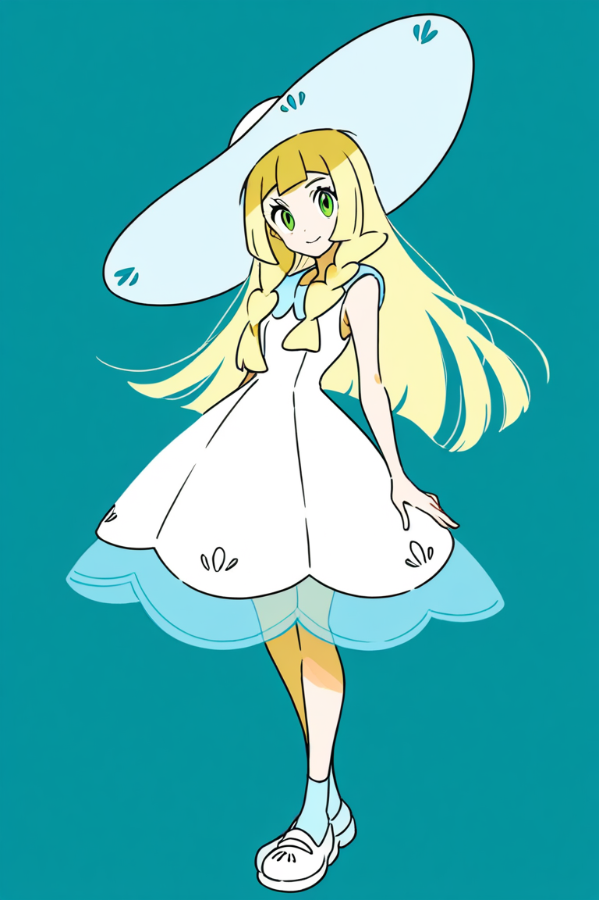

# 莉莉艾：Animagine LoRA 对照实验

此目录公开生成图、分项评价、训练/推理参数及核验摘要；不包含模型权重、训练缓存、参考原作、应用数据库或密钥。
图片为原始生成文件，没有修图、重抽种子或为展示重绘。重复出现在不同实验中的底模/旧图明确标为复用。

## 结论

三轮均未通过目标画风验收。连续增加到 160 步没有形成明确的细彩线、通透虹膜和柔和光影；
将学习率从 5e-5 提高到 2e-4 后，变化增大，但黑色粗轮廓和硬边阴影更突出。
训练完成、权重加载成功和去噪损失下降不等于画风改善。评价是助手直接看图的定性分析，不是本地视觉模型评分。

## 1. 连续训练：底模与 40 / 80 / 160 步

| 底模 | 40 步 |
| --- | --- |
|  |  |
| 80 步 | 160 步 |
|  |  |

[完整评价](lillie-continuous-160/report.json)。40 步图经过权重数值与原调用核验后复用；80、160 步当轮新生成。

## 2. 全身照：底模与旧 160 步

| 底模 | 160 步，学习率 5e-5 |
| --- | --- |
|  |  |

[完整评价](lillie-fullbody-160/report.json)。金发、绿眼睛、白裙及全身入镜基本保持，但画风改善不明显。

## 3. 提高学习率的单变量试验

| 底模 | 旧 160 步：5e-5 | 新 160 步：2e-4 |
| --- | --- | --- |
|  |  |  |

[完整评价与诊断](lillie-fullbody-lr2e4/report.json)，[35 项技术核验](lr-audit.json)。
新方案从底模重新训练 160 步，不是旧权重累计训练到 320 步。训练数据、rank、分辨率、脚本、编码缓存、
初始验证值和样本顺序保持一致。推理为同题、seed 42、768×1152、28 步、CFG 5、Euler a、CLIP skip 2，
两组 LoRA 强度均为 1。底模和旧图复用，新图为新训练权重的实际输出。

## 参数、来源与限制

- [完整正负提示词、采样设置、训练统计](protocol.json)
- [生成图片 SHA-256](checksums.json)
- [训练脚本与复现步骤说明](../../docs/LORA.md)
- 网页查看：启动本地应用后，在「小笑 → LoRA 实验」查看本机已归档数据。本目录是便于 GitHub 阅读的结果快照，不自动写入新安装的画师数据库。

训练使用 10 张独立原作的 20 个视图，开发验证参考曾参与方案讨论，不是独立盲测集。
单角色单种子无法证明稳定泛化，去噪 MSE 不能换算成画风相似度。没有将新权重设为默认模型。
本公开目录未包含训练图和权重，因此仅凭此目录不能重新训练出相同权重。

本地对照中使用的参考来源仅以链接记录，不转载作品文件：
[78296295](https://www.pixiv.net/artworks/78296295)、
[77171026](https://www.pixiv.net/artworks/77171026)、
[94442641](https://www.pixiv.net/artworks/94442641)。
